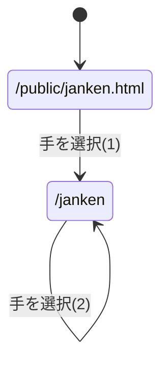

# webpro_06のページ遷移図

### じゃんけん関係
#### ページ遷移図

#### (1)のパラメータ

パラメータ名 | 属性 | 内容 | 値
-|-|-|-
hand | text | ユーザの手 | グー/チョキ/パー
win | hidden | 勝利数 | 0
total | hidden | 対戦数 | 0

#### (2)のパラメータ

パラメータ名 | 属性 | 内容 | 値
-|-|-|-
hand | text | ユーザの手 | グー/チョキ/パー
win | hidden | 勝利数 | これまでの勝利数
total | hidden | 対戦数 | これまでの対戦数

#### (3)
要素名 | 説明
-|-
type | 入力欄に指定
name | 送信するデータの名前を指定
id | HTML要素を識別するため

#### (4)
htmlファイルは静的なファイルである．そのため，固定されたwebページを作成するときに用いられる．ejsファイルは動的なページである．そのため内容が変化するページに用いられる．node.jsではテンプレートファイルとして用いられることがよくある．